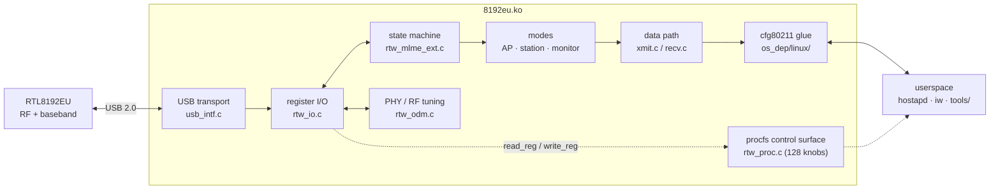

# rtl8192eu-advanced

Linux driver for the **TP-Link TL-WN822N v4** (Realtek **RTL8192EU**, USB `2357:0108`) — and any other RTL8192EU adapter.

Built on Realtek's official **v5.11.2.1** base (newer than TP-Link's own 2015 driver and the Mange community mirror), with the known bugs fixed and reverse-engineered control added on top. Running in production as a hostapd AP.

## Architecture



- `driver/core/` — vendor core: state machine, modes, PHY tuning, data path, procfs
- `driver/os_dep/linux/` — USB transport + cfg80211 glue
- `tools/` — LED control, monitor injection test, usbmon parser
- `docs/` — the reverse-engineering results (wire protocol, register map, Windows OID surface)

## Install

```bash
git clone https://github.com/thenabbu/rtl8192eu-advanced.git
cd rtl8192eu-advanced/driver
sudo -S -p '' ./install_wifi.sh
```

Manual build / DKMS / per-distro packages: [`driver/README.md`](driver/README.md).

For AP duty, load with power management off:

```bash
sudo -S -p '' modprobe 8192eu rtw_power_mgnt=0 rtw_enusbss=0
```

Module name stays `8192eu`, so existing `modprobe.d` options and udev rules keep working. CI builds on Ubuntu 22.04 (5.15) and 24.04 (6.8) on every push.

## Fixed over the official and community builds

| Bug | Fix |
|---|---|
| `Runtime PM usage count underflow!` on every `rmmod` | PM hold guard |
| Kernel stack dump on every monitor → AP switch | missing `MLME_IS_MONITOR` branch |
| Monitor mode compiled out of stock | `CONFIG_WIFI_MONITOR=y` |
| `tx_power_offset` knob set but never read | wired into the TX power target |
| TX injection impossible in monitor mode | carrier fix + radiotap check |
| dmesg flooded with PHYDM printks | dynamic debug — quiet by default |
| build breaks on Ubuntu 24.04 HWE kernels | dual-ABI `set_monitor_channel` guard |

Every fix has A/B kernel-log proof in [`docs/bugs-found.md`](docs/bugs-found.md).

## Verified on live hardware

- **AP:** clients re-associate ~9 s after a module bounce, zero warnings in a full day
- **Monitor RX:** 838 frames in 8 s · **Monitor TX:** 10/10 injected frames on the wire
- **TX power:** offset 0/1/4 → 16/17/20 dBm, exact restore
- **LED:** full on/off/blink control via `tools/rtlled.sh`

## Control surface

- 128 procfs knobs — incl. raw register `read_reg` / `write_reg`, TX power offset (0–5 dBm), LED state
- Monitor mode RX + injection (`tools/inject_test.py`)
- USB-level trace tooling (`tools/usbmon_parse.py` + captures in `captures/`)

## Docs

| File | What it covers |
|---|---|
| [`docs/usb-protocol.md`](docs/usb-protocol.md) | wire protocol, register map, init phases, firmware download |
| [`docs/windows-vendor-oids.md`](docs/windows-vendor-oids.md) | the full Windows vendor OID surface — 53 OIDs, both handlers decoded |
| [`docs/monitor-injection.md`](docs/monitor-injection.md) | injection failure chain + the usbmon truncation trap |
| [`docs/txpower-control.md`](docs/txpower-control.md) | TX power formula and every knob |
| [`docs/led-control.md`](docs/led-control.md) | LED registers and semantics |
| [`docs/feature-matrix.md`](docs/feature-matrix.md) | official vs community vs this driver |
| [`docs/bugs-found.md`](docs/bugs-found.md) | every bug, with before/after log proof |

---

Base tree imported verbatim from the official 5.11.2.1 mirror (hashes in `MANIFEST.md`); this series is the commit history on top. GPL-2.0.
